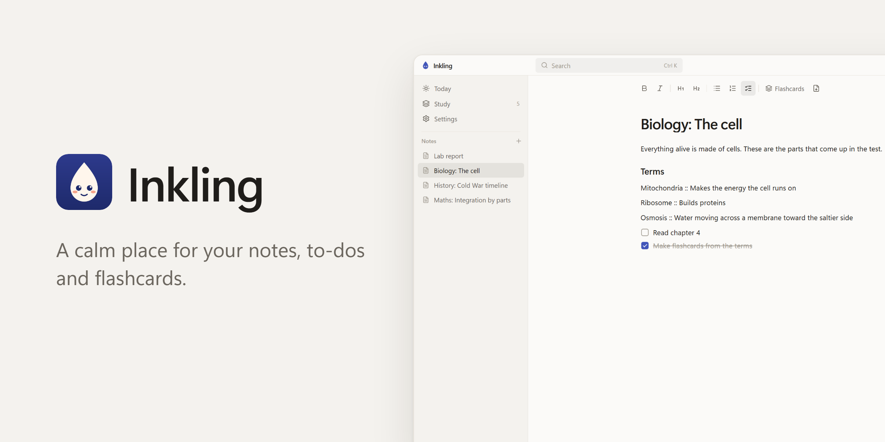

<div align="center">



<br />

[](https://github.com/dominikkoenitzer/Inkling/actions/workflows/ci.yml)
[](https://github.com/dominikkoenitzer/Inkling/releases/latest)
[](LICENSE)

A calm place for your notes, to-dos and flashcards. Local, offline, nothing to sign up for.

</div>

## Download

**[Download Inkling for Windows](https://github.com/dominikkoenitzer/Inkling/releases/latest/download/Inkling-Setup.exe)**, then double-click it. It installs and opens on its own.

Also for [macOS](https://github.com/dominikkoenitzer/Inkling/releases/latest/download/Inkling-mac.dmg) (Intel and Apple Silicon) and [Linux](https://github.com/dominikkoenitzer/Inkling/releases/latest/download/Inkling.AppImage).

If Windows says it protected your PC, click **More info**, then **Run anyway**. Inkling updates itself after that.

<p align="center">
  
</p>

## What it does

- **Notes.** Type anywhere, it saves as you go. `#` makes a heading, `-` a list, `[]` a to-do.
- **To-dos live in your notes.** Every open checkbox, from every note, shows up on Today. Tick it there or in the note, it is the same box.
- **Today.** What is still open and which flashcards are due, on one quiet page.
- **Flashcards from your notes.** Write `Term :: Definition`, press Flashcards, and the note becomes a deck. Each card comes back right before you would forget it.
- **Search.** `Ctrl+K` finds any note, to-do or deck.
- **Light and dark.** Both calm, both easy on the eyes.

<p align="center">
  
</p>

<p align="center">
  
</p>

## Keyboard

| Keys | What it does |
|---|---|
| `Ctrl+K` | Search |
| `Ctrl+N` | New note |
| `Ctrl+,` | Settings |
| `Space`, then `1` to `4` | In a review: show the answer, then Again, Hard, Good or Easy |

## Your data

Everything stays on your computer, in one SQLite file in `%APPDATA%\Inkling` (Windows), `~/Library/Application Support/Inkling` (macOS) or `~/.config/Inkling` (Linux). Each time Inkling starts, a copy goes into `backups/` next to it, and the last five are kept. Any note can be saved as Markdown from the button above it.

## Build it yourself

You need [Git](https://git-scm.com), [Bun](https://bun.sh) and [Node.js](https://nodejs.org) 22 or newer. On Windows:

```powershell
winget install --id Git.Git -e
winget install --id Oven-sh.Bun -e
winget install --id OpenJS.NodeJS.LTS -e
```

Then, in a new terminal:

```bash
git clone https://github.com/dominikkoenitzer/Inkling.git
cd Inkling
bun install
node node_modules/electron/install.js   # fetches the Electron app if bun skipped it
bun run dev                             # opens Inkling with live reload
```

On Windows, `scripts\setup.ps1` does the same checks and steps for you and tells you what is missing.

Other scripts:

```bash
bun run test        # unit tests
bun run typecheck   # TypeScript
bun run lint        # ESLint
bun run build       # production bundle into out/
bun run smoke       # starts the built app off screen and checks notes, to-dos, search and reviews
bun run dist        # Windows installer into release/
```

## How it is built

Electron with React 19, TypeScript, Tailwind CSS 4 and TipTap for the editor. Data goes through typed repositories over better-sqlite3 with FTS5 search. Spaced repetition is an FSRS-6 scheduler in `src/shared/fsrs.ts`.

```
src/main       main process: database, migrations and backups, IPC, the data repositories
src/preload    the bridge the app talks through (window.inkling, typed in src/shared/api.ts)
src/renderer   the React app: shell, today, notes, study
src/shared     types and the pure logic both sides use: FSRS, cloze, Markdown export
test           Vitest suites
```

For screenshots and the smoke test, development builds read `INKLING_USERDATA` (separate profile), `INKLING_SEED` (demo notes), `INKLING_SCREENSHOT` and `INKLING_EVAL`. Release builds ignore all but the first.

See [`CHANGELOG.md`](CHANGELOG.md) for what changed in each version.

## License

[MIT](LICENSE)

Made by [@dominikkoenitzer](https://github.com/dominikkoenitzer).
