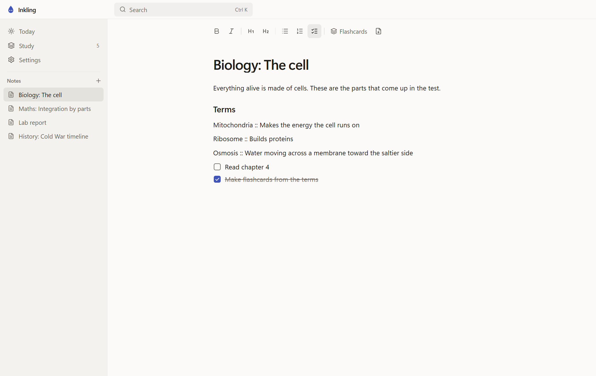
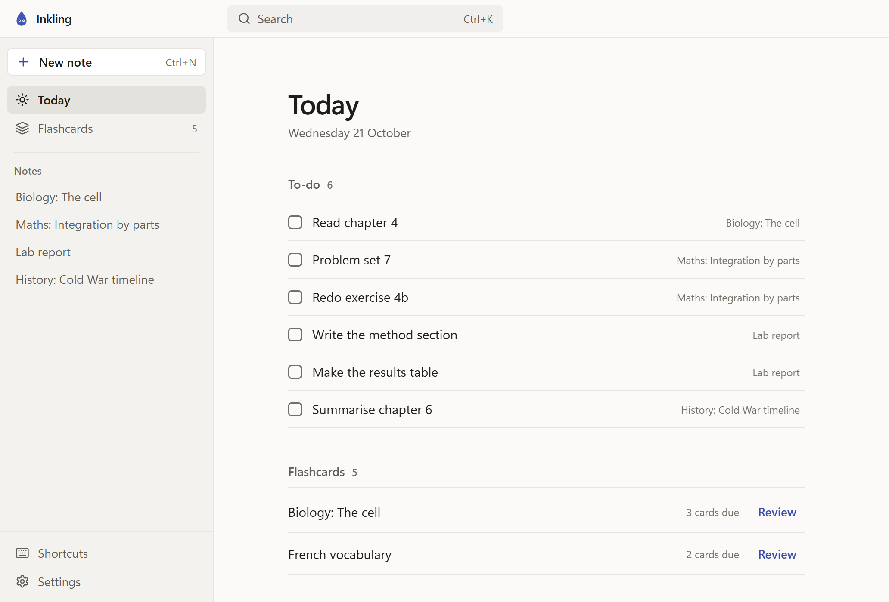
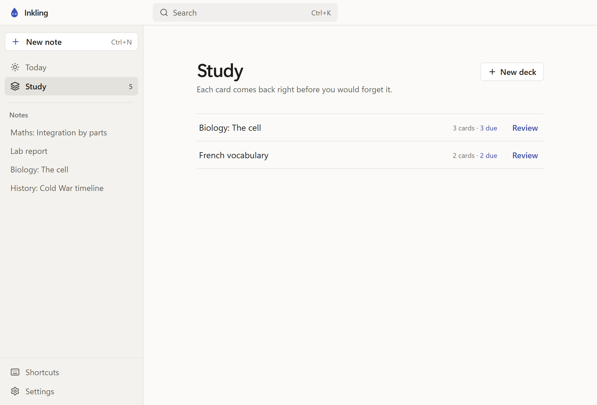

# Inkling

[](https://github.com/dominikkoenitzer/Inkling/actions/workflows/ci.yml)

Inkling is a desktop app for studying from your own notes: the to-dos and flashcards you write in a note come together on one Today page, and everything stays on your computer.

<p align="center">
  
</p>

## Download

**[Download Inkling for Windows](https://inkling.punds.ch)**, then double-click it. It installs and opens on its own, and there is no account to make.

Windows may say "Windows protected your PC"; click More info, then Run anyway.

For macOS and Linux, see [Other ways to install](#other-ways-to-install).

## What it does

- Type anywhere in a note and it saves as you go. `#` makes a heading, `-` a list, `[]` a to-do.
- Every open to-do from every note shows up on Today, next to the flashcard decks with cards due. Tick a to-do there or in the note; it is the same box.
- Write `Term :: Definition` in a note and press Flashcards, and the note becomes a deck. Cloze lines such as `{{c1::Bern}} is the capital of Switzerland` work too. On the Flashcards page you can also make a deck by hand.
- Each card comes back right before you would forget it. The scheduler is FSRS-6.
- `Ctrl+K` finds any note, to-do or deck.
- Light and dark themes.

<p align="center">
  
</p>

<p align="center">
  
</p>

## Keyboard

| Keys | What it does |
|---|---|
| `Ctrl+K` | Search, or jump to Today, Flashcards and Settings |
| `Ctrl+N` | New note |
| `Ctrl+1`, `Ctrl+2` | Today, Flashcards |
| `Ctrl+,` | Settings |
| `F1` | All shortcuts |
| `Ctrl+Enter` | In a note: tick the to-do the cursor is in |
| `Space`, then `1` to `4` | In a review: show the answer, then Again, Hard, Good or Easy |

On a Mac, press `Cmd` where the table says `Ctrl`, and `Cmd+/` for all shortcuts.

## Other ways to install

- macOS, Intel and Apple Silicon: paste `curl -fsSL https://inkling.punds.ch/install | sh` into Terminal. It puts Inkling into Applications and opens it, and running it again updates it. You can also download [Inkling-mac.dmg](https://inkling.punds.ch), open it and drag Inkling into Applications; macOS then asks you to allow it once under System Settings, Privacy & Security.
- Linux: [Inkling.AppImage](https://inkling.punds.ch). Make it executable with `chmod +x Inkling.AppImage`, then run it.
- Every version is on the [releases page](https://github.com/dominikkoenitzer/Inkling/releases).

## Use it with an AI assistant

Inkling has an MCP server built in, so an AI assistant on your computer can look through your notes, write and tidy them, keep your to-dos going and quiz you on your flashcards.

Open Settings (Ctrl+,) and find Connect an AI assistant. It lists the assistant apps on your computer that Inkling can set up by itself: click Connect, then restart the assistant. Disconnect takes Inkling out again. Every other server in the assistant's settings stays as it was.

For any other assistant, click Copy setup in the same place and paste it into the assistant's MCP settings. It holds the path where Inkling is installed. By hand, on Windows, it looks like this:

```json
{
  "mcpServers": {
    "inkling": {
      "command": "C:\\Users\\<you>\\AppData\\Local\\Programs\\Inkling\\Inkling.exe",
      "args": ["--mcp"]
    }
  }
}
```

On macOS the command is `/Applications/Inkling.app/Contents/MacOS/Inkling`, on Linux the full path to your `Inkling.AppImage`. Write the path out in full; most clients do not expand `%LOCALAPPDATA%` or `~`.

What the assistant can do:

- search notes, to-dos and decks, list your notes (the ones changed lately or the ones in the trash too) and read a note, or one section of it, as Markdown
- make a note, add to the end of a note or of one section, replace a section, swap a piece of text for another and rename a note. Headings, lists, bold, italic, links, code and quotes all come through, and a `- [ ]` line becomes a real to-do on Today
- take its own edits back, one at a time
- move a note to the trash and bring it back
- see what Today shows, tick to-dos off or open them again
- quiz you on the flashcards that are due and rate each answer the way a review does, add flashcards, or turn a note's `Term :: Definition` lines into its deck

Most assistants also show three ready prompts: plan my day, quiz me, and flashcards from a note.

How your notes stay safe:

- Nothing is deleted for good. A deleted note waits in the trash for 30 days and the assistant can bring it back.
- Before its first change in a session, your data is copied into `backups` as `assistant-` and the date. The last three are kept.
- An edit changes only the lines it touches. A to-do that keeps its text keeps its date, and a reworded card line keeps its review history. Making flashcards from a note never removes a card; that stays your click in the app.
- Its changes go through the same code as the app's own, so to-dos, flashcards and search stay in step.

Open Inkling once before you connect it, so it can set up your data. After an update, open it once more before the assistant carries on. Inkling can stay open while the assistant works: open notes and Today show the changes within a couple of seconds. If you type in the same note at that very moment, what you type wins; the assistant's undo or the backup bring its version back.

Inkling sends nothing over the network here. The assistant app starts Inkling itself and they talk over standard input and output. What the assistant reads becomes part of your conversation with it.

## Your data, updates and removal

Your notes, to-dos and cards live in one SQLite file, `inkling.db`, in `%APPDATA%\Inkling` on Windows, `~/Library/Application Support/Inkling` on macOS and `~/.config/Inkling` on Linux. Each time Inkling starts, a copy goes into `backups` next to it, and the last five are kept. An assistant adds its own, see above. The export button above a note saves it as Markdown.

The installed app goes online for one thing: when it starts, it checks for a new version. On Windows and Linux it downloads the update in the background and installs it when you close Inkling. On macOS, run the install command above again.

To remove Inkling on Windows, uninstall it under Settings > Apps > Installed apps. Your notes stay. To delete them too, close Inkling and delete these folders:

- `%APPDATA%\Inkling`: your notes and the backups
- `%LOCALAPPDATA%\inkling-updater`: downloaded updates
- `%TEMP%\inkling-mcp`: only there if you used the AI assistant connection

On macOS, move Inkling from Applications to the Trash, then delete `~/Library/Application Support/Inkling` and `~/Library/Caches/inkling-updater`. On Linux, delete the AppImage, `~/.config/Inkling` and `~/.cache/inkling-updater`.

## Build from source

You need [Git](https://git-scm.com), [Bun](https://bun.sh) 1.4.2 (the version CI uses) and [Node.js](https://nodejs.org) 22 or newer. On Windows:

```powershell
winget install --id Git.Git -e
winget install --id Oven-sh.Bun -e --version 1.4.2
winget install --id OpenJS.NodeJS.LTS -e
```

Then, in a new terminal:

```bash
git clone https://github.com/dominikkoenitzer/Inkling.git
cd Inkling
bun install
node node_modules/electron/install.js   # fetches the Electron app if bun skipped it
bun run dev                             # opens Inkling with live reload
```

On Windows, `powershell -ExecutionPolicy Bypass -File scripts\setup.ps1` checks that Git, Bun and Node.js 22 or newer are there, installs the packages, fetches Electron and runs the tests.

Other scripts:

```bash
bun run test        # unit tests
bun run typecheck   # TypeScript
bun run lint        # ESLint
bun run build       # production bundle into out/
bun run smoke       # starts the built app off screen and checks notes, to-dos, search, reviews and that no view cuts off a letter
bun run mcp         # runs the MCP server from the built app, on stdin and stdout
bun run mcp:smoke   # talks to the built app's MCP server over stdio and checks every tool
bun run dist        # Windows installer into release/
```

## How it is built

Electron with React 19, TypeScript, Tailwind CSS 4 and TipTap for the editor. Data goes through typed repositories over better-sqlite3 with FTS5 search. Spaced repetition is an FSRS-6 scheduler in `src/shared/fsrs.ts`.

```
src/main       main process: database, migrations and backups, IPC, the data repositories, the MCP server
src/preload    the bridge the app talks through (window.inkling, typed in src/shared/api.ts)
src/renderer   the React app: shell, today, notes, study
src/shared     types and the pure logic both sides use: FSRS, cloze, Markdown export
test           Vitest suites
```

For screenshots and the smoke test, development builds read `INKLING_USERDATA` (separate profile), `INKLING_SEED` (demo notes), `INKLING_SCREENSHOT` and `INKLING_EVAL`. Release builds ignore all but the first.

## More

- [CHANGELOG.md](CHANGELOG.md): what changed in each version
- [CONTRIBUTING.md](CONTRIBUTING.md): local setup, code style and the checks a change has to pass
- [SECURITY.md](SECURITY.md): how to report a vulnerability privately

## License

[MIT](LICENSE)

Made by [@dominikkoenitzer](https://github.com/dominikkoenitzer).
